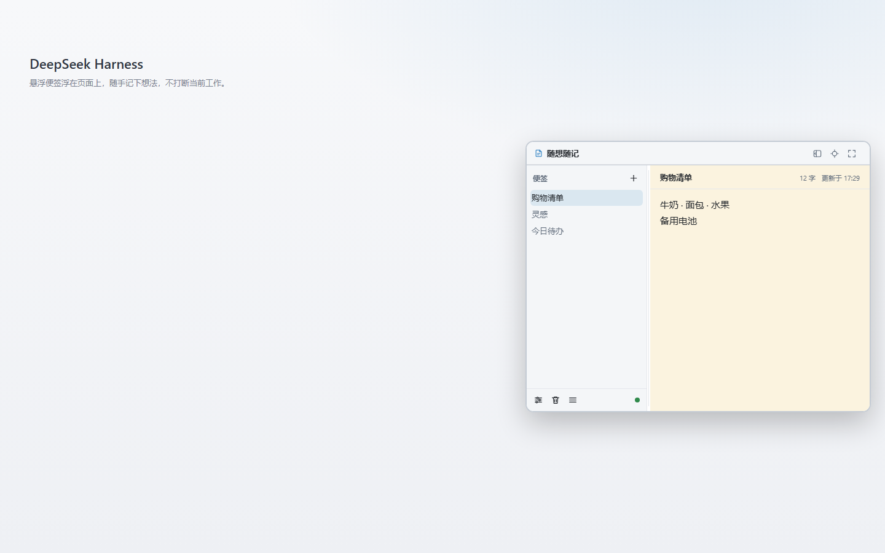
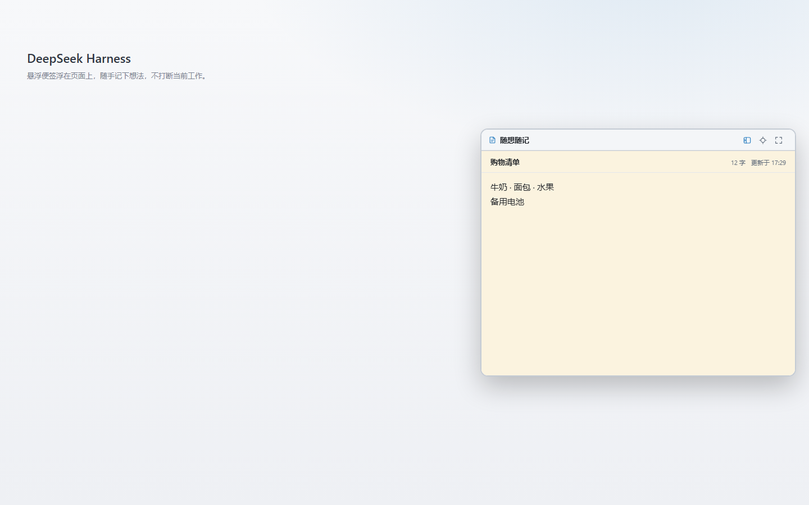

# Quick Notes (`dsh-quick-notes`)

[](https://www.npmjs.com/package/dsh-quick-notes)
[](LICENSE)
[](package.json)

A floating sticky-note pad for the DeepSeek Harness (DSH) Web GUI. Keep a few
short notes in a small window above your session — ideas, to-dos, a phone number,
something you need to remember — and the plugin saves them for you automatically.

English · [简体中文](README.zh.md)

## What it is for

While you work in DSH, you often need a scratchpad that stays visible without
taking over the screen. Quick Notes puts a movable note window over the
interface. You can keep several notes in a list, switch between them, and close
or minimize the window whenever you want. The notes are saved on your computer,
so they are still there after a page refresh or a DSH restart.

Typical uses:

- write down an idea or a question before it slips away;
- keep a short to-do list next to the conversation;
- park a snippet of text or a screenshot that you will need in a minute;
- keep temporary information (a command, an address, a draft reply).

## Features

- **Several notes in one place** — a directory on the left, the current note on
  the right; create, rename, pin, delete and drag to reorder.
- **Recycle bin** — deleted notes are kept for a while and can be restored, so a
  mis-click is not the end of the world.
- **Simple text editing** — bold, italic and underline, plus copy, cut, paste and
  clear formatting from the right-click menu.
- **Pictures** — paste or drag a screenshot into a note; it is scaled down
  automatically so it fits the window.
- **A window that stays out of the way** — move it by the title bar, resize it,
  switch to notes-only mode, or shrink it to a small floating ball.
- **Size and position are remembered** — including a “reset to default size” and
  “reset to default position” action.
- **Settings** — font size, line height, light / dark / follow-system theme, ruled
  paper, and JSON export / import for backups.
- **English and Chinese interface** — the UI follows the DSH language.

## Screenshots





Screenshots are taken from the released 1.0.0 build. See
[`assets/README.md`](https://github.com/LittleLemonJam/dsh-quick-notes/blob/main/assets/README.md)
for how they are produced and updated.

## Installation

Quick Notes needs **DeepSeek Harness 0.2.0 or newer**. Node.js **22.13 or newer** is
what the plugin's local data service expects; DSH ships its own Node runtime, so you
only need Node on your machine when building from source.

### From the DSH UI

1. Open the **Plugins** page in the DSH sidebar.
2. Click **Add plugin → Install a third-party plugin**, enter `dsh-quick-notes`
   and confirm.
3. Restart DSH once if the plugin does not appear immediately, then open the
   notes window from the notes icon at the bottom of the left sidebar.

If you use a plugin market — the built-in **Plugins → Discover** tab with an
index source configured, or the community dshmarket plugin under
**Settings → Plugin market** — you can also search for **Quick Notes** (or
**随想随记**) there and install it.

### With the command line

```bash
dsh plugin --profile web add dsh-quick-notes
```

`web` is the profile name the DSH Web UI uses; replace it with your own profile
name when you use a different one. If the written window does not appear, restart
DSH so the local data service can start.

### From a local checkout (development)

```bash
git clone https://github.com/LittleLemonJam/dsh-quick-notes.git
cd dsh-quick-notes
npm install
npm run build
dsh plugin add link:/absolute/path/to/dsh-quick-notes
```

You can also point DSH at the folder from the **Plugins** page →
**Add plugin → Install a third-party plugin** and select the directory that
contains `package.json`.

## Getting started

1. Click the notes icon at the bottom of the left sidebar. The note window opens.
2. Press `+` in the directory to create a note, type a name, and press `Enter`.
3. Type in the note body. There is no save button; changes are written
   automatically after you pause for a moment.
4. Add more notes whenever you need them, and click a note in the directory to
   switch to it.

### Working with notes

- Double-click a note name in the directory to rename it.
- Double-click the title above the editor to rename the current note in place.
- Use the pin button on a row to keep an important note at the top.
- Drag rows up or down to change the order, or press `Alt` + `↑` / `↓` while a row
  is focused.
- Deleting a note sends it to the recycle bin; the bin can restore it or delete it
  permanently.

### Formatting

Select some text and right-click inside the editor. The menu contains:

| Action           | What it does                                           |
| ---------------- | ------------------------------------------------------ |
| Copy             | Copy the selection to the system clipboard             |
| Cut              | Copy the selection and remove it                       |
| Paste            | Insert the clipboard content at the caret              |
| Clear formatting | Remove bold / italic / underline and pasted formatting |

On the keyboard, `Ctrl`/`Cmd` + `B`, `I` and `U` toggle bold, italic and
underline. `Ctrl`/`Cmd` + `V` pastes plain text or cleaned HTML.

Paste or drag a PNG, JPEG, WebP or GIF picture into a note to attach it. Large
pictures are scaled down to fit the window; SVG and remote image links are not
kept.

### Window controls

The title bar has three buttons:

- **Notes only** — hide the directory and make the window narrow.
- **Minimize to ball** — shrink the window to a small floating ball; click the
  ball to bring the window back.
- **Reset window size** — return to the default 560 × 440 size while keeping the
  current position.

Drag the title bar to move the window, and use the eight edge / corner handles to
resize it. The window cannot be smaller than 320 × 240, and it never covers the
native DSH title bar at the top of the screen.

### Settings and backup

Open the gear at the bottom of the directory:

- **Font size** (13–20) and **line height** (1.4–2.0);
- **Theme**: follow the DSH theme, or pin the notes to light or dark;
- **Reset window position**: move the window back to the right side of the DSH
  frame;
- **Export JSON / Import JSON**: save a backup file or restore one;
- **Sync status**: see whether the current change has been stored.

Ruled paper is toggled by the three-line button next to the recycle bin.

## Data and privacy

- Notes are stored locally at `~/.dsh/quick-notes/notes.json`
  (`%USERPROFILE%\.dsh\quick-notes\notes.json` on Windows). If `DSH_HOME` is
  set, the file lives under that directory instead.
- You can move the data directory with the `DSH_QUICK_NOTES_DIR` environment
  variable.
- The browser keeps a local copy so the window keeps working if the local data
  service is briefly unavailable. The file is the shared copy; the browser copy
  is a fallback.
- **The plugin does not upload anything.** Note content is not sent to any
  server; there is no account and no telemetry. The data file is plain JSON, so
  use disk encryption if the notes are sensitive.
- You can back up your notes with **Settings → Export JSON** or by copying
  `notes.json` while DSH is closed.

## Compatibility

| Component        | Requirement                           |
| ---------------- | ------------------------------------- |
| DeepSeek Harness | 0.2.0 or newer                        |
| Node.js          | 22.13 or newer (DSH runtime / builds) |
| DSH surface      | DSH Desktop / DSH Web GUI             |
| Data format      | `schemaVersion: 1`                    |

## Documentation

- [User guide](docs/user-guide.md) (Chinese) — every action in detail.
- [FAQ](docs/faq.md) (Chinese) — where the data lives, backups, uninstall and
  common questions.
- [Data and storage](docs/storage.md) (Chinese) — file format, local fallback
  and recovery.
- [Development guide](docs/development.md) (Chinese) — build, test and local
  installation.
- [Contributing](CONTRIBUTING.md) — environment, code style and pull requests.
- [Security policy](SECURITY.md) — how to report a security problem.
- [Changelog](CHANGELOG.md) and [1.0.0 release notes](docs/release-notes-1.0.0.md).
- [Architecture contract](docs/architecture.md) (Chinese) — for maintainers.

## Development

```bash
npm install
npm run build      # regenerate client.js; the built file is committed
npm run verify     # formatting + static checks + unit tests
```

The repository is a DSH bundle: `index.js` and `src/host/` register the local
data routes, `src/client/` is the browser-side window, and `client.js` is the
generated Client bundle. See the [development guide](docs/development.md) for the
full layout.

## License

[MIT](LICENSE) © 2026 LittleLemonJam
