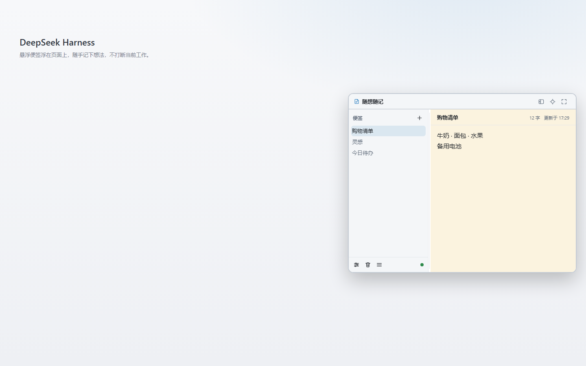
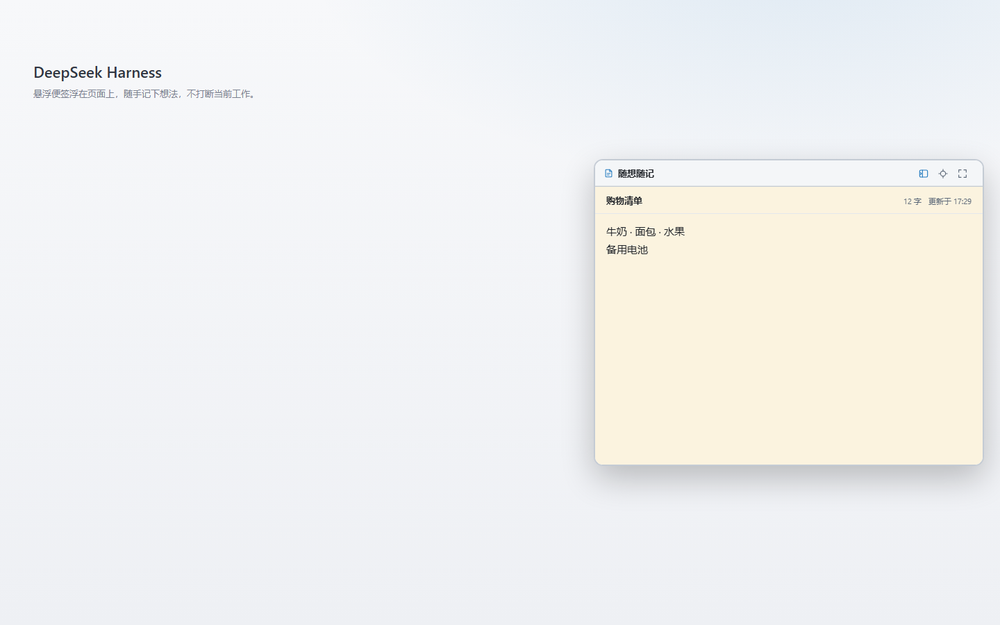

# 随想随记（`dsh-quick-notes`）

[](https://www.npmjs.com/package/dsh-quick-notes)
[](LICENSE)
[](package.json)

DeepSeek Harness（DSH）Web 界面的悬浮便签本。在界面上留一个小小的便签窗口，随手
记下想法、待办、临时信息；内容会自动保存，刷新页面或重启 DSH 后还在。

[English](README.md) · 简体中文

## 这是什么

在 DSH 里工作时，经常需要一个不挡事、随时能写的草稿本。随想随记把便签窗口浮在界面
上方：可以放多条便签、随时切换，窗口能移动、能收起，也可以缩成一个小圆球。便签保存在
你自己的电脑上，不需要注册账号，也不会传到网上。

常见用法：

- 想到什么先记下来，免得一会儿忘了；
- 在对话旁边放一份简短的待办清单；
- 先存一段稍后要用的文字或截图；
- 记下临时的命令、地址、草稿。

## 功能

- **多条便签集中管理** —— 左侧目录、右侧正文；可以新建、重命名、置顶、删除和拖拽排序。
- **回收站** —— 删除的便签会先放进回收站，误删了可以还原。
- **简单的文字编辑** —— 粗体、斜体、下划线，右键菜单提供复制、剪切、粘贴、清除格式。
- **插入图片** —— 粘贴或拖入截图，会自动缩小到适合窗口的大小。
- **不挡事的窗口** —— 按住标题栏移动、拖边框缩放，可切换「仅便签」，也可缩成悬浮圆球。
- **记住窗口状态** —— 位置和大小会保留，另有「恢复默认大小」「恢复默认位置」按钮。
- **设置** —— 字号、行高、浅色 / 深色 / 跟随系统主题、横线衬底，以及 JSON 导出 / 导入备份。
- **中英双语界面** —— 跟随 DSH 当前语言显示。

## 截图





截图来自 1.0.0 正式版。生成与更新方式见
[`assets/README.md`](https://github.com/LittleLemonJam/dsh-quick-notes/blob/main/assets/README.md)。

## 安装

随想随记需要 **DeepSeek Harness 0.2.0 或更新版本**。Node.js **22.13 或更新版本**
是插件本地数据服务要求的运行时；DSH 自带 Node，所以只有从源码构建时才需要自己装 Node。

### 从 DSH 界面安装

1. 打开左侧栏的 **插件（Plugins）** 页。
2. 点 **添加插件（Add plugin）→ 安装第三方插件（Install a third-party plugin）**，
   填入 `dsh-quick-notes` 并确认。
3. 如果插件没有立刻出现，重启一次 DSH；然后点击左侧侧栏底部的便签图标打开窗口。

如果你在使用插件市场（内置的 **插件 → 发现** 标签页配置索引源，或社区 dshmarket
插件的 **设置 → 插件市场**），也可以直接搜索「随想随记」（或 **Quick Notes**）安装。

### 用命令行安装

```bash
dsh plugin add dsh-quick-notes
```

如果你有多个 DSH profile，在命令里加 `--profile <名称>`。装好后窗口没有出现时，重启
一次 DSH，让本地数据服务加载起来。

### 从本地代码安装（开发）

```bash
git clone https://github.com/LittleLemonJam/dsh-quick-notes.git
cd dsh-quick-notes
npm install
npm run build
dsh plugin add link:/本目录的绝对路径
```

也可以在 **插件页 → 添加插件 → 安装第三方插件** 里选择包含 `package.json` 的本目录
完成安装。

## 快速上手

1. 点击左侧侧栏底部的便签图标，打开便签窗口。
2. 点目录上方的 `+` 新建便签，输入名称后按 `Enter`。
3. 直接在正文里输入。没有「保存」按钮，停手片刻后内容会自动写入。
4. 需要时继续新建便签，点目录中的便签即可切换。

### 管理便签

- 双击目录中的便签名称可以重命名。
- 双击编辑器上方的标题，可以就地重命名当前便签。
- 点便签行上的置顶按钮，可以把重要便签固定在列表顶部。
- 按住便签行上下拖动可以调整顺序；也可以聚焦某行后按 `Alt` + `↑` / `↓`。
- 删除会把便签放进回收站；回收站里可以还原或彻底删除。

### 格式

在正文里选中文字后点右键，菜单只有四项：

| 操作     | 作用                                   |
| -------- | -------------------------------------- |
| 复制     | 把选区复制到系统剪贴板                 |
| 剪切     | 复制选区并从便签中移除                 |
| 粘贴     | 把剪贴板内容插入光标处                 |
| 清除格式 | 去掉粗体、斜体、下划线和粘贴带入的格式 |

键盘上 `Ctrl`/`Cmd` + `B`、`I`、`U` 分别是粗体、斜体、下划线；
`Ctrl`/`Cmd` + `V` 粘贴纯文本或清洗后的 HTML。

把 PNG、JPEG、WebP、GIF 图片粘贴或拖进便签，就会插入到正文里。大图会自动缩小到
适合窗口的大小；SVG 和网络图片链接不会保留。

### 窗口操作

标题栏有三个按钮：

- **仅便签** —— 隐藏左侧目录，窗口收窄。
- **缩成圆球** —— 把窗口缩成一个小圆球，点圆球恢复窗口。
- **恢复默认大小** —— 回到默认的 560 × 440 大小，位置不变。

按住标题栏可以移动窗口，拖 8 个边角手柄可以缩放。窗口最小 320 × 240，并且不会盖住
DSH 顶部的原生标题栏区域。

### 设置与备份

点目录底部的齿轮：

- **字号**（13–20）和**行高**（1.4–2.0）；
- **主题**：跟随 DSH、浅色、深色；
- **恢复默认位置**：把窗口移回 DSH 界面右侧中间；
- **导出 JSON / 导入 JSON**：保存或恢复备份；
- **同步状态**：查看当前修改是否已经写入本地文件。

横线衬底开关在回收站右侧（三横线按钮）。

## 数据与隐私

- 便签保存在本机：`~/.dsh/quick-notes/notes.json`（Windows 上是
  `%USERPROFILE%\.dsh\quick-notes\notes.json`）。如果设置了 `DSH_HOME`，则保存在
  该目录下。
- 可以用环境变量 `DSH_QUICK_NOTES_DIR` 把数据目录换到别处。
- 浏览器里也保留一份副本，本地数据服务暂时不可用时窗口仍然可以工作；文件是共享的
  主数据，浏览器副本只是兜底。
- **插件不会上传任何内容**：便签不会发到任何服务器，没有账号，也没有遥测。数据文件是
  明文 JSON，如果便签内容敏感，请开启磁盘加密。
- 可以用 **设置 → 导出 JSON** 备份，或在关闭 DSH 后直接复制 `notes.json`。

## 兼容性

| 组件             | 要求                                  |
| ---------------- | ------------------------------------- |
| DeepSeek Harness | 0.2.0 或更新版本                      |
| Node.js          | 22.13 或更新版本（DSH 运行时 / 构建） |
| DSH 界面         | DSH Desktop / DSH Web GUI             |
| 数据格式         | `schemaVersion: 1`                    |

## 文档

- [用户手册](docs/user-guide.md) —— 每一项功能的详细说明。
- [常见问题](docs/faq.md) —— 数据在哪、如何备份、如何卸载等。
- [数据与持久化](docs/storage.md) —— 文件格式、本地兜底与恢复。
- [开发指南](docs/development.md) —— 构建、测试与本地安装。
- [贡献指南](CONTRIBUTING.md) —— 环境、代码风格与 PR。
- [安全策略](SECURITY.md) —— 如何报告安全问题。
- [更新日志](CHANGELOG.md) 与 [1.0.0 发布说明](docs/release-notes-1.0.0.md)。
- [架构契约](docs/architecture.md) —— 供维护者参考。

## 开发

```bash
npm install
npm run build      # 重新生成 client.js（构建产物需要提交）
npm run verify     # 格式检查 + 静态检查 + 单元测试
```

这是一个 DSH bundle：`index.js` 和 `src/host/` 注册本地数据路由，`src/client/` 是
浏览器端的窗口，`client.js` 是生成的 Client 构建产物。完整目录结构见
[开发指南](docs/development.md)。

## 许可证

[MIT](LICENSE) © 2026 LittleLemonJam
